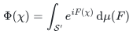
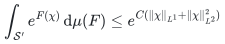
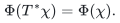
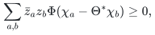

**RP O(d) trick (RP1)**

**Disclaimer:** these documents are largely LLM-created. Their correctness has not been satisfactorily verified.

Project codename: **RP1**.

- **[RPO1](RP1O1.pdf)** — [Reflection positivity to rotations: expanded proof outline](RP1O1.pdf).
- **AI-written manuscript:** **[RPM1](RPM1.pdf)** — [Rotation invariance from lattice symmetry and reflection positivity](RPM1.pdf) · [TeX source](RPM1.tex).
- **Human-written manuscript:** to be added.

**Main theorem**

The statement below is taken from [Theorem A](RPM1.pdf) of **[RPM1](RPM1.pdf)**, with its notation from the manuscript. The TeX formatting and macros have been adapted for GitHub.

Fix a number $`d\geq 2`$, and consider $`d`$-dimensional Euclidean spacetime $`\mathbb{R}^d`$.

Here $`\mathcal{T}`$ is a finite-dimensional real orthogonal representation of $`\mathrm{O}(d)`$ whose planar rotation weights lie in $`\{-2,-1,0,1,2\}`$.

The space $`\mathcal{S}=\mathcal{S}(\mathbb{R}^d;\mathcal{T})`$ is the Fréchet space of real
Schwartz tests, and $`\mathcal{S}'`$ is its continuous dual with the weak-$`*`$
topology. The Euclidean inner product on $`\mathcal{T}`$ fixes the pointwise norm
and hence the $`L^1`$ and $`L^2`$ norms.

By a “random distribution” is meant a Borel probability measure

<!-- display-math:eq-168-f98781a9cc
\mu:\mathrm{Borel}(\mathcal{S}')\to [0,1]
-->
<p align="center">
  <picture>
    <source media="(prefers-color-scheme: dark)" srcset="../assets/eq-168-f98781a9cc.dark.svg">
    
  </picture>
</p>

on $`\mathcal{S}'`$, which we assume possesses well-defined moments $`S_N: \mathcal{S}^N\to \mathbb{R}`$. Let $`\Phi:\mathcal{S}\to \mathbb{C}`$ denote the characteristic function

<!-- display-math:eq-169-96b1f0387e
\Phi(\chi) = \int_{\mathcal{S}'} e^{iF(\chi)} \,\mathrm{d} \mu(F)
-->
<p align="center">
  <picture>
    <source media="(prefers-color-scheme: dark)" srcset="../assets/eq-169-96b1f0387e.dark.svg">
    
  </picture>
</p>

of the measure.

Let $`\mathcal{S}_N \subset \mathcal{S}^N`$ denote the set of tuples $`\chi=(\chi_1,\dots,\chi_N)`$ such that the test functions $`\chi_\bullet`$'s have pairwise disjoint supports.

Let $`\mathcal{N}`$ denote the set of all hyperplanes $`\subset \mathbb{R}^d`$ of the form

<!-- display-math:eq-170-735497e9c8
\{x_j=0\}\quad(0\leq j\leq d-1),\qquad \{x_j+x_k=0\},\quad \{x_j-x_k=0\}
-->
<p align="center">
  <picture>
    <source media="(prefers-color-scheme: dark)" srcset="../assets/eq-170-735497e9c8.dark.svg">
    
  </picture>
</p>

for $`0\leq j<k\leq d-1`$ in the latter two families.

For an isometry $`T(\mathbf{x})=g\mathbf{x}+\mathbf{a}`$, our pullback convention is

<!-- display-math:eq-171-94025f21a5
(T^*\chi)(\mathbf{x})=\rho(g)\chi(T\mathbf{x}),\qquad
 (T_1T_2)^*=T_2^*T_1^*.
-->
<p align="center">
  <picture>
    <source media="(prefers-color-scheme: dark)" srcset="../assets/eq-171-94025f21a5.dark.svg">
    
  </picture>
</p>

Here $`\rho(g)`$ is the pullback action on the tensor indices; thus
$`\rho(g_1g_2)=\rho(g_2)\rho(g_1)`$. It is an isometry for real $`g`$.

**[Theorem A](RPM1.pdf).**

Suppose that:

**(i)**  There exists a constant $`C>0`$ such that

<!-- display-math:eq-172-4cde52454c
\int_{\mathcal{S}'} e^{F(\chi)} \,\mathrm{d} \mu(F) \leq e^{C(\lVert\chi\rVert_{L^1}+\lVert\chi\rVert_{L^2}^2)}
-->
<p align="center">
  <picture>
    <source media="(prefers-color-scheme: dark)" srcset="../assets/eq-172-4cde52454c.dark.svg">
    
  </picture>
</p>

for every real $`\chi\in\mathcal{S}`$.

**(ii)**

The measure is invariant under spacetime translations. That is, for any $`T:\mathbb{R}^d\to \mathbb{R}^d`$ of the form $`T(\mathbf{x})=\mathbf{x}+\mathbf{a}`$ for $`\mathbf{a}\in \mathbb{R}^d`$,

<!-- display-math:eq-173-dbc34c76f6
\Phi(T^* \chi) = \Phi(\chi).
-->
<p align="center">
  <picture>
    <source media="(prefers-color-scheme: dark)" srcset="../assets/eq-173-dbc34c76f6.dark.svg">
    
  </picture>
</p>

**(iii)** The measure is reflection positive across each of the hyperplanes $`H\in \mathcal{N}`$: for any finite sequence $`\chi_0,\chi_1,\dots \in \mathcal{S}`$ of test functions supported on one side of $`\mathbb{R}^d\backslash H`$, and for any $`z_\bullet\in \mathbb{C}`$,

<!-- display-math:eq-174-3e40b7bfcd
\sum_{a,b} \bar{z}_a z_b \Phi(\chi_a - \Theta^* \chi_b ) \geq 0,
-->
<p align="center">
  <picture>
    <source media="(prefers-color-scheme: dark)" srcset="../assets/eq-174-3e40b7bfcd.dark.svg">
    
  </picture>
</p>

where $`\Theta:\mathbb{R}^d\to\mathbb{R}^d`$ denotes reflection across the hyperplane $`H`$.

Then the measure is rotationally-invariant in the sense of Osterwalder--Schrader, meaning $`S_N(R^* \chi) = S_N(\chi)`$ for all $`R\in \mathrm{O}(d)`$ and $`\chi\in \mathcal{S}_N`$.

Here, $`R^* \chi=(R^* \chi_1,\dots,R^* \chi_N)`$.

**Building the manuscript**

The TeX sources are beside the PDFs. Build in a temporary copy of these files, retain the resulting PDF, and remove the temporary build directory.

For [RPM1.tex](RPM1.tex):

```sh
pdflatex -no-shell-escape -interaction=nonstopmode RPM1.tex
biber RPM1
pdflatex -no-shell-escape -interaction=nonstopmode -halt-on-error RPM1.tex
pdflatex -no-shell-escape -interaction=nonstopmode -halt-on-error RPM1.tex
pdflatex -no-shell-escape -interaction=nonstopmode -halt-on-error RPM1.tex
```

The first pass may report symbol-footnote counter errors before page assignments settle; the later passes must finish successfully.

**Historical source of the scalar supplement**

The scalar application on [RPO1, page 33](RP1O1.pdf) uses the [preserved 27-page RPM1 edition, Section 11](RPM1-27-page.pdf), with [exact TeX line references](RPM1-27-page.tex) and the [matching TeX/bibliography archive](RPM1-27-page-source.zip). This is the historical edition; the current [RPM1](RPM1.pdf) has 30 pages.
